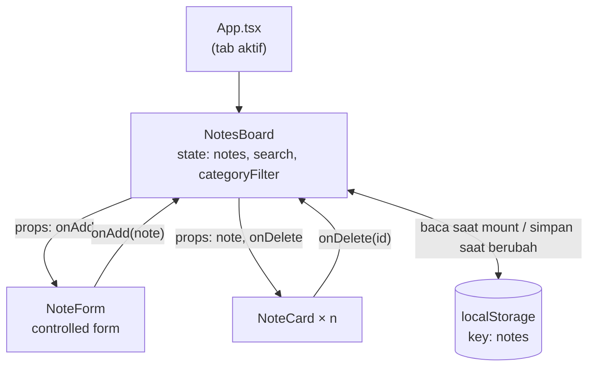
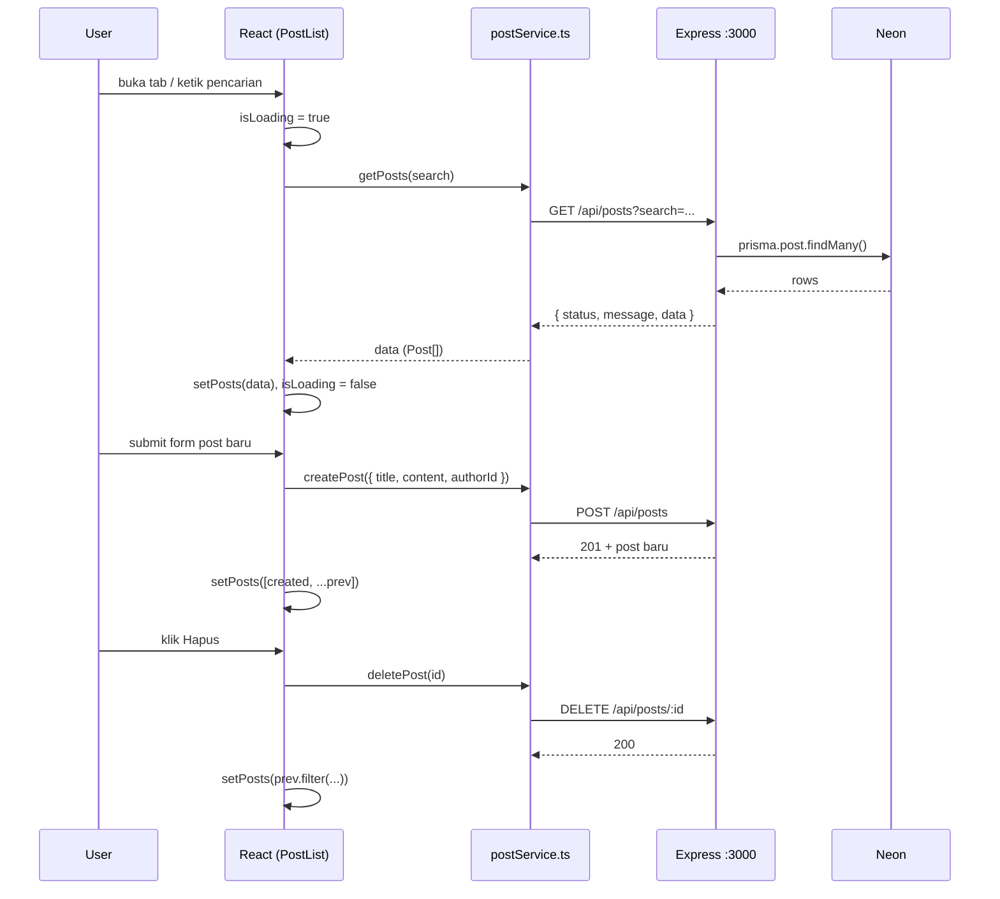

# Challenge Praktikum Modul 5 – Kelompok B05

Aplikasi **Papan Catatan & Posts** untuk Challenge Praktikum Modul 5 (Fundamental React dengan TypeScript).

- **Frontend**: Vite + React 19 + TypeScript
- **Backend**: Express 5 + Prisma 7 + Neon PostgreSQL (lanjutan Modul 4) + `cors`

Aplikasinya satu halaman dengan dua tab:

| Tab | Isi | Data disimpan di |
| --- | --- | --- |
| **Tahap 1: Catatan Lokal** | Tambah, cari, filter, dan hapus catatan | `localStorage` browser |
| **Tahap 2: Posts (API)** | Lihat, tambah, cari, dan hapus post | Database Neon lewat REST API |

---

## Struktur Folder

```text
challenge-react-b05/
├── backend/                     # REST API Modul 4
│   ├── prisma/
│   │   ├── migrations/          # riwayat migrasi database
│   │   ├── schema.prisma        # model User & Post
│   │   └── seed.ts              # data awal (1 user + 2 post)
│   ├── src/
│   │   ├── config/prisma.ts     # koneksi Prisma ke Neon
│   │   ├── controllers/         # logika user & post
│   │   ├── middlewares/         # logger + error handler
│   │   ├── routes/              # /api/users, /api/posts
│   │   ├── utils/               # sendSuccess, HttpError, parseId
│   │   └── index.ts             # server utama (+ cors)
│   ├── .env.example
│   └── prisma.config.ts
│
└── frontend/                    # Aplikasi React
    └── src/
        ├── components/
        │   ├── NotesBoard.tsx   # halaman Tahap 1
        │   ├── NoteForm.tsx
        │   ├── NoteCard.tsx
        │   ├── PostList.tsx     # halaman Tahap 2
        │   ├── PostForm.tsx
        │   └── PostCard.tsx
        ├── hooks/useLocalStorage.ts
        ├── services/postService.ts
        ├── types/
        │   ├── note.ts
        │   └── post.ts
        ├── App.tsx              # navigasi tab
        └── main.tsx
```

Pembagian folder frontend mengikuti Modul 5 bagian 12: **`types/`** untuk interface, **`components/`** untuk UI, **`hooks/`** untuk custom hook, dan **`services/`** untuk fungsi `fetch`.

---

## Tahap 1 – Papan Catatan Lokal

### Alur komponen



State `notes` disimpan di **parent** (`NotesBoard`). Child hanya menerima data dan fungsi callback lewat props (*lifting state up*).

### Pengerjaan per poin

**1. Interface `Note`** (`src/types/note.ts`)

```ts
export const NOTE_CATEGORIES = ["Kuliah", "Pribadi", "Kerja", "Lainnya"] as const;
export type NoteCategory = (typeof NOTE_CATEGORIES)[number];

export interface Note {
  id: number;
  title: string;
  content: string;
  category: NoteCategory;
}
```

Kategori dibuat sebagai pilihan tetap. Dengan begitu daftar yang sama bisa dipakai untuk `<select>` di form dan di filter, dan TypeScript menolak kategori di luar daftar.

**2. Komponen `NoteForm` dan `NoteCard`**

- `NoteForm` adalah **controlled form**: `title`, `content`, dan `category` masing-masing punya `useState` dan terhubung ke `value` + `onChange`. Saat submit, form menjalankan `e.preventDefault()`, membuat objek `Note` dengan `id: Date.now()`, mengirimnya ke parent lewat `onAdd`, lalu mengosongkan input.
- `NoteCard` menerima props `note` dan `onDelete`, lalu menampilkan judul, badge kategori, isi, dan tombol **Hapus**.

State diubah secara **immutable**, sesuai aturan di Modul 5:

```ts
setNotes([note, ...notes]);                         // tambah
setNotes(notes.filter((note) => note.id !== id));   // hapus
```

**3. Pencarian / filter dengan `.filter()`**

Hasil pencarian tidak disimpan di state terpisah. Hasilnya dihitung ulang dari `notes` setiap kali komponen render:

```ts
const filteredNotes = notes.filter((note) => {
  const matchTitle = note.title.toLowerCase().includes(search.toLowerCase());
  const matchCategory = categoryFilter === "Semua" || note.category === categoryFilter;
  return matchTitle && matchCategory;
});
```

Pencarian judul tidak membedakan huruf besar/kecil. Sebagai tambahan, ada juga filter berdasarkan kategori.

**4. Simpan ke `localStorage`**

Memakai custom hook `useLocalStorage` (`src/hooks/useLocalStorage.ts`):

- Nilai awal dibaca dari `localStorage` lewat **lazy initializer** `useState(() => ...)`, jadi hanya dibaca sekali saat mount.
- `useEffect(..., [key, value])` menyimpan ulang data setiap kali `notes` berubah.

Hasilnya, catatan tetap ada setelah halaman di-refresh.

---

## Tahap 2 – Integrasi REST API Modul 4

### Alur data full-stack



### Pengerjaan per poin

**1. Server Express + Neon + `cors`**

Backend memakai kode Modul 4 (schema `User`/`Post`, controller, `sendSuccess`, `HttpError`, `errorHandler`). Karena React berjalan di port `5173` dan Express di port `3000`, kami menambahkan CORS di `backend/src/index.ts`:

```ts
app.use(cors({ origin: "http://localhost:5173" }));
```

**2. Menampilkan daftar Post + loading + error**

`PostList.tsx` memakai pola tiga state dari Modul 5: `posts`, `isLoading`, dan `error`. Tampilannya dipilih dengan conditional rendering:

| Kondisi | Tampilan |
| --- | --- |
| `isLoading` | "Memuat posts..." |
| `error` | Pesan error + tombol **Coba lagi** |
| `posts.length === 0` | "Belum ada post." |
| selain itu | Grid `PostCard` |

Semua `fetch` dikumpulkan di `services/postService.ts`, lewat satu helper `request()` yang:

- mengubah kegagalan jaringan (server mati atau diblokir CORS) menjadi pesan *"Tidak bisa terhubung ke server. Pastikan backend sudah dinyalakan."*;
- membaca `message` dari response backend jika status bukan 2xx;
- mengembalikan field `data` dari format response `{ status, message, data }` Modul 4.

**3. Tambah post (`POST`) dan hapus post (`DELETE`) tanpa refresh**

- `PostForm` adalah controlled form berisi judul, isi, dan **penulis**. Penulis dibutuhkan karena `POST /api/posts` di Modul 4 mewajibkan `authorId`. Daftar penulis diambil dari `GET /api/users` saat form pertama kali muncul.
- Setelah server membalas `201`, post baru langsung dimasukkan ke state: `setPosts((prev) => [created, ...prev])`.
- Tombol **Hapus** memanggil `DELETE /api/posts/:id`. Jika berhasil, post dibuang dari state dengan `.filter()`. Selama request berjalan, tombolnya menampilkan "Menghapus..." dan dinonaktifkan.

**4. (Bonus) Pencarian ke backend lewat `useEffect(..., [search])`**

```ts
useEffect(() => {
  let ignore = false;
  const timer = setTimeout(async () => {
    // fetch GET /api/posts?search=...
  }, 400);

  return () => {        // cleanup
    ignore = true;
    clearTimeout(timer);
  };
}, [search, reloadKey]);
```

- Setiap kali `search` berubah, effect berjalan ulang dan mengirim `?search=` ke backend. Backend memfilter judul dengan `contains` + `mode: "insensitive"` (sudah tersedia dari Modul 4).
- **Debounce 400 ms**: request baru dikirim setelah user berhenti mengetik, supaya tidak ada request di setiap ketukan tombol.
- **Cleanup + flag `ignore`**: kalau user mengetik lagi sebelum request selesai, hasil yang lama diabaikan sehingga tidak menimpa hasil terbaru.
- `reloadKey` dipakai oleh tombol **Coba lagi** untuk memicu fetch ulang.

---

## Endpoint yang Dipakai

| Method | Endpoint | Dipakai untuk |
| --- | --- | --- |
| `GET` | `/health` | Cek koneksi server + database |
| `GET` | `/api/posts?search=` | Daftar post + pencarian |
| `POST` | `/api/posts` | Tambah post `{ title, content, authorId }` |
| `DELETE` | `/api/posts/:id` | Hapus post |
| `GET` | `/api/users` | Pilihan penulis di form post |

---

## Cara Menjalankan

Prasyarat: **Node.js 24 LTS** dan project database di [Neon](https://neon.tech).

### 1. Backend

```bash
cd backend
npm install
cp .env.example .env               # isi DATABASE_URL (pooled) & DATABASE_URL_UNPOOLED (direct)
npx prisma migrate dev             # buat tabel User & Post di Neon
npx prisma generate                # generate Prisma Client
npm run seed                       # 1 user demo + 2 post
npm run dev                        # http://localhost:3000
```

Buka `http://localhost:3000/health`. Jika muncul `"Server dan database OK"`, koneksi ke Neon berhasil.

### 2. Frontend (terminal baru)

```bash
cd frontend
npm install
npm run dev                        # http://localhost:5173
```

---

## Skenario Demo

1. **Tahap 1**: tambah beberapa catatan dengan kategori berbeda, cari berdasarkan judul, filter kategori, hapus satu catatan, lalu **refresh** halaman. Catatan masih ada.
2. **Tahap 2**: daftar post muncul setelah teks "Memuat posts...". Tambah post baru, dan post langsung muncul di paling atas. Hapus post, dan post langsung hilang. Ketik di kolom pencarian, dan daftar terfilter dari backend.
3. **Error handling**: matikan server backend (`Ctrl+C`), lalu buka ulang tab Tahap 2. Muncul pesan error dan tombol **Coba lagi**. Nyalakan lagi backend, lalu klik **Coba lagi**.

---

## Pengujian yang Sudah Dilakukan

- `npm run typecheck` (backend) dan `npm run build` + `npm run lint` (frontend) tanpa error.
- Uji API dengan `curl` ke database Neon: `GET /health`, `GET /api/posts` (dengan header CORS untuk origin `localhost:5173`), preflight `OPTIONS`, `POST /api/posts` (201), `?search=` (tidak membedakan huruf besar/kecil), `DELETE` (200, lalu 404 jika dihapus ulang), dan `POST` tanpa judul (400).
